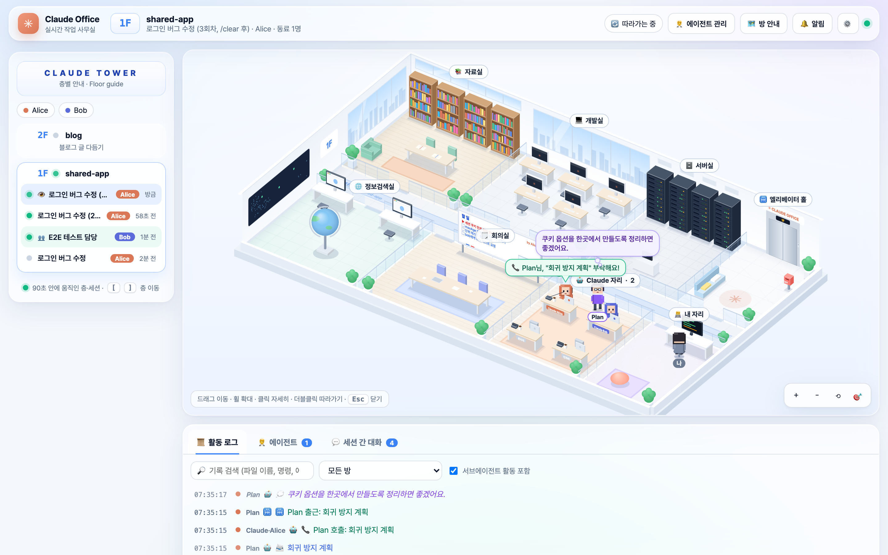
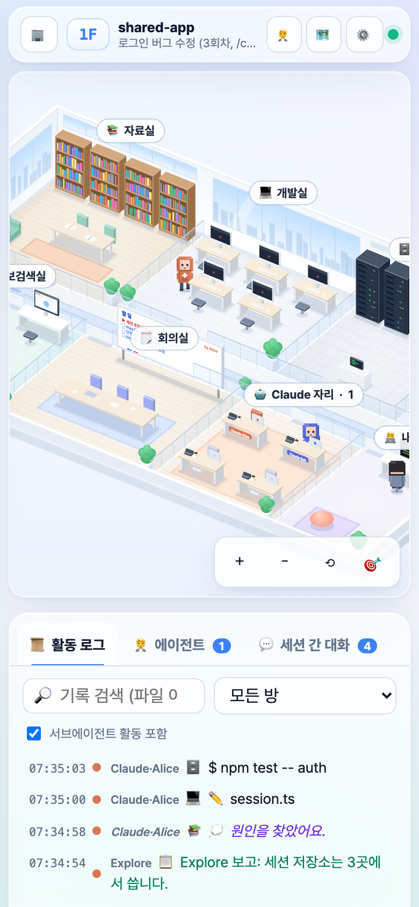
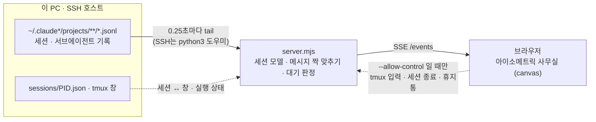

<div align="center">

# ✳ Claude Office

**Claude Code가 지금 뭘 하고 있는지, 작은 사무실로 보여 주는 실시간 대시보드**

파일을 읽으면 자료실로, 명령을 돌리면 서버실로, 막히면 그 자리에서 턱을 괴고 고민합니다.<br>
서브에이전트는 엘리베이터를 타고 출근하고, 여러 계정의 Claude가 한 사무실에서 메시지를 주고받아요.




<sub>데모 데이터 화면: Alice의 Claude가 Plan 에이전트에게 전화를 걸고, Plan이 엘리베이터로 출근해 지시를 받는 장면</sub>

</div>

---

## ✨ 무엇을 하나요

| | |
|---|---|
| 🏢 **살아 있는 사무실** | 심즈처럼 위에서 사선으로 내려다보는 3D 사무실. 도구에 따라 Claude가 방을 옮겨 다니고, 생각·말·실패가 말풍선으로 뜹니다. |
| 🛗 **서브에이전트 출퇴근** | 일을 맡기면 엘리베이터로 출근 → 방을 오가며 일함 → Claude에게 보고 → "👋 퇴근합니다!" |
| 👥 **여러 계정, 한 사무실** | 같은 폴더에서 일하는 다른 Claude 계정들이 같은 층에 계정별 색깔로 함께 출근합니다. |
| 💬 **세션 간 대화** | `tmux send-keys` · SendMessage로 주고받은 메시지를 찾아, 보낸 Claude가 받는 Claude에게 걸어가 전달합니다. |
| 🧑‍💼 **에이전트 관리** | 건물 전체 에이전트를 한 표로: 상태 · 경과 · 토큰 · 오류. 멈춘 에이전트 감지와 한 번에 정리. |
| ✋ **결정 대기함** | 권한 승인 · 선택 질문 · 계획 승인 · 질문으로 끝난 턴 · 다른 세션 답 기다림을 모든 층 · 계정 · 서버에서 한곳에 모읍니다. 사무실에선 머리 옆에 ✋가 떠요. |
| 🗂️ **세션 관리** | 모든 세션을 한 표로(열려 있음 · 대기 · 꺼짐 · 오래됨). 오래된 세션은 claude를 **실제로 종료**하고 기록을 휴지통으로 옮겨 정리합니다(되돌리기 가능). |
| 🖱 **GUI처럼** | 마우스를 올리면 정보 카드, 클릭하면 상세 패널(지시 · 보고 · 타임라인 · 이어서 하기 명령). |
| 🖥 **SSH · tmux** | 원격 VM의 세션도 SSH로 읽어 옵니다(원격엔 `python3`만). 세션이 도는 tmux 창도 정확히 찾아요. |
| 🎮 **조종 (선택)** | `--allow-control`을 켜면 화면에서 그 tmux 창으로 메시지 · Esc를 보내고, 세션을 종료하거나 휴지통으로 옮깁니다. |
| 📱 **휴대폰** | `--share`로 같은 와이파이의 휴대폰에서 봅니다(접속 키 필요, 보기 전용). |

설치할 패키지가 없고, Claude Code의 훅이나 설정도 건드리지 않습니다. 기본은 Claude Code가 남기는 세션 기록(`~/.claude*/projects/**/*.jsonl`)을 **읽기만** 해요. 입력 · 종료 · 정리는 `--allow-control`을 켰을 때만 됩니다.

## 🚀 빠른 시작

필요한 것: **Node.js 18+**, 그리고 Claude Code를 한 번이라도 쓴 기록.

```bash
git clone https://github.com/morae00/claude-office.git
cd claude-office
node server.mjs --open          # → http://localhost:4747
```

먼저 구경만 하려면 데모를 돌려 보세요. 가짜 기록으로 두 계정(Alice · Bob)이 tmux로 대화하고 서브에이전트가 출퇴근합니다. 권한 승인 · 선택 질문을 기다리는 세션과 정리할 오래된 세션도 있어서, 세션 관리의 종료 · 휴지통도 가짜 데이터로 눌러 볼 수 있어요.

```bash
node demo.mjs                   # → http://localhost:4748
```

자주 쓰는 조합:

```bash
node server.mjs --ssh myvm                          # 원격 VM 세션까지 함께
node server.mjs --ssh myvm --allow-control --share  # + 화면에서 조종 + 휴대폰으로 보기
```

---

## 🏠 방마다 맡은 일

| 방 | 언제 가나 | 모습 |
|---|---|---|
| 📚 자료실 | Read · Grep · Glob · Skill · ToolSearch | 책장 앞에서 책을 펴고 읽음 |
| 💻 개발실 | Edit · Write · NotebookEdit | 아이맥 화면에 코드가 흐름 |
| 🗄️ 서버실 | Bash · git · 백그라운드 작업 | 명령이 도는 동안 랙 불빛이 빨라짐 |
| 🌐 정보검색실 | WebSearch · WebFetch · MCP 도구 · 브라우저 | 지구본이 빨리 돌고 브라우저가 로딩 |
| 🗒️ 회의실 | TodoWrite · Task · 계획 모드 · 워크플로 | 화이트보드에 할 일 · 계획이 적힘 |
| 🤖 Claude 자리 | 서브에이전트 호출 · 메시지 · 대기 | 전화 걸기, 커피, 오래 쉬면 졸기 |
| 🧑‍💻 내 자리 | AskUserQuestion · 계획 승인 · 파일 전달 | 내 책상까지 찾아와서 물어봄 |
| 🛗 엘리베이터 홀 | 서브에이전트 출퇴근 · 다른 층 메시지 | 문이 열리고 닫힘, 📮 우체통 |

생각할 땐 그 자리에서 턱을 괴고 구름 말풍선을, 도구가 실패하면 식은땀과 빨간 말풍선을 띄웁니다. 30분 넘게 조용하면 사무실 불이 어두워져요. 상단 🗺 **방 안내**(`L`)를 켜면 방마다 오는 도구가 늘 표시됩니다.

**서브에이전트 옷차림**: Explore 초록 옷 + 탐험 모자 · Plan 보라 옷 + 안경 · general-purpose 파란 옷 + 헤드셋 · 워크플로 청록 옷 + 안전모 · 그 밖의 커스텀 에이전트는 이름별 색 + 모자

## 🏢 층별 안내 — 층 · 세션 · 계정

| 화면 | 뜻 |
|---|---|
| **3F 프로젝트명** | 작업 폴더 하나 = 한 층. 그 폴더에서 연 세션은 계정이 달라도 모두 이 층에 모입니다. |
| 층 아래 각 줄 | 그 폴더의 Claude 세션 하나(`claude`를 켜거나 `/clear`할 때마다 한 줄). |
| 색깔 배지 | 그 세션을 돌린 Claude 계정(`CLAUDE_CONFIG_DIR`). 사무실 안 후드 색과 같아요. |
| `🪟 master` | 그 세션이 지금 돌고 있는 tmux 창 |
| `✋` / `✋2` | 그 세션(층)이 내 결정 · 답을 기다림 — 아래 ✋ 결정 대기함 |
| `🖥 myvm` | 그 층이 SSH로 읽어 온 원격 호스트에 있음 |
| 왼쪽 동그라미 | 초록 = 90초 안에 움직임, 깜빡임 = 작업 중, 회색 = 쉬는 중 |
| 👁 / 📌 / 👥 | 지금 보는 세션(최신 세션 따라가기) / 고정한 세션 / 같은 층 동료 |

- 층 번호는 서버를 켤 때 **최근에 쓴 프로젝트부터 1층, 2층…**. 그 뒤에 처음 생긴 프로젝트는 꼭대기 층에 올라갑니다.
- 층을 누르면 "▲ 3F" 엘리베이터와 함께 이동하고 그 층의 최근 세션을 **따라갑니다**. 같은 폴더에서 `/clear`하거나 `claude`를 다시 켜면 새 세션으로 넘어가요.
- 세션 줄을 누르면 📌 고정, "🔄 최근 세션 따라가기"로 되돌립니다. 7일 넘게 쉰 층은 접어 둡니다.

## 🖱 화면 다루기

| 동작 | 결과 |
|---|---|
| 캐릭터 · 방 · 물건에 **마우스 올리기** | 정보 카드: 지금 하는 일, 몇 초째인지, 마지막 요청, 도구 · 오류 · 컨텍스트, 그 방에 오는 도구와 최근 활동 |
| **클릭** | 오른쪽 상세 패널 |
| **더블클릭** / 🎯 | 카메라가 그 캐릭터를 따라감 |
| 드래그 · 휠 | 이동 · 확대 |
| 🔔 알림 | 결정을 기다리는 세션이 생기거나 작업이 끝나면 브라우저 알림 |

단축키: `+` `-` 확대·축소 · `0` 처음 화면 · `F` 따라가기 · `A` 에이전트 탭 · `W` 결정 대기 · `S` 세션 관리 · `L` 방 안내 · `[` `]` 층 이동 · `Esc` 닫기

**상세 패널**
- **Claude** — 상태, 지금 하는 일과 경과 시간, 도구 · 오류 · 요청 수, 입력/출력 토큰, 컨텍스트, 모델, 마지막 요청 전문, 부른 서브에이전트, 타임라인. `⌨️ 이어서 하기 명령 복사`(`claude --resume …`), 세션 ID · 기록 파일 경로 복사, VS Code로 폴더 열기, 📌 고정
- **서브에이전트** — 받은 지시 전문, 보고 전문, 출근 · 일한 시간 · 마지막 활동, 도구 · 오류 · 토큰, 타임라인, 소속 Claude로 이동
- **방 · 물건** — 방 설명과 도구 목록, 지금 있는 사람, 최근 활동. 화이트보드는 할 일 전체, 우체통은 세션 간 대화, 엘리베이터는 층 목록으로

## 🧑‍💼 에이전트 관리 · 모니터링

아래 **🧑‍💼 에이전트** 탭은 건물 전체(최근 15분 안에 움직인 세션)의 Claude와 서브에이전트를 한 표로 보여 줍니다.

- 상태: 🟢 일하는 중 · 💭 생각 중 · ❓ 질문 대기 · **💤 멈춤**(설정한 시간 동안 기록 없음, 기본 5분) · 📋 보고 중 · ✅ 퇴근 · ❌ 실패 · 👻 연락 끊김
- 이 층 / 건물 전체, 상태별 필터, 검색, 열 머리글로 정렬(출근 · 마지막 활동 · 도구 · 오류 · 토큰)
- 줄에 마우스를 올리면 사무실에서 그 캐릭터가 강조되고, 누르면 그 캐릭터로 이동(다른 층이면 엘리베이터로)
- **🏠 퇴근시키기 / 🙈 숨기기**, **💤 멈춘 에이전트 모두 퇴근**, **✅ 끝난 기록 정리**로 화면을 정리
- 멈춘 에이전트가 생기면 상단에 `💤 멈춘 에이전트 N` 버튼과 알림

정리는 화면에서만 일어납니다. 실제 백그라운드 에이전트를 멈추려면 에이전트 패널의 **🛑 중지 요청**으로 "…를 TaskStop으로 중지해줘" 문구를 소속 Claude에게 보내세요.

## ✋ 결정 대기함 · 🗂️ 세션 관리

**✋ 결정 대기** 탭(상단 `✋ 결정 대기 N` 버튼, `W`)은 Claude가 **내 결정이나 답을 기다리는 세션**을 모든 층 · 계정 · SSH 서버에서 모아 보여 줍니다. 오래 기다린 것부터, 질문 내용과 선택지까지 카드로 나와요.

| 표시 | 언제 | 어떻게 알아내나 |
|---|---|---|
| 🔐 권한 승인 대기 | 명령 실행 · 파일 수정 등을 해도 되는지 묻는 중 | 상태 파일이 "기다림" + 기록에 아직 결과가 없는 도구 호출 |
| ❓ 선택 질문 | AskUserQuestion으로 선택지를 내놓고 기다림 | 상태 파일 + 기록의 질문 · 선택지 |
| 🗒️ 계획 승인 대기 | 계획 모드에서 계획을 올리고 승인 대기 | 상태 파일 + 기록의 계획 전문 |
| 🪟 창 응답 대기 | 그 밖의 선택 창이 떠 있음 (기록에 아직 없는 질문 포함) | 상태 파일 + **그 tmux 창의 지금 화면** |
| 💬 내 답장 대기 | "…할까요?"처럼 질문으로 턴을 끝내고 쉬는 중 | 마지막 응답의 끝 문장 |
| 📨 다른 세션 답 대기 | 다른 세션에 물어보고(또는 "답 기다릴게요") 턴을 끝냄 | 세션 간 메시지 + 끝 문장 |

- 카드마다 **🙋 묻는 쪽**(어느 계정 · 세션의 Claude) · **📍 답할 곳**(그 claude가 도는 tmux 창, 예: `dev:0.0 %3`) · **✅ 닫히는 때**, 그리고 알 수 있으면 **📨 일을 맡긴 쪽**(이 세션에 마지막으로 메시지를 보낸 세션)이 나옵니다. 아무도 그 tmux 세션에 붙어 있지 않으면 `ssh -t myvm tmux attach -t …` 안내도 붙어요.
- 상태 파일은 Claude Code가 실행 중인 claude마다 남기는 `<CLAUDE_CONFIG_DIR>/sessions/<pid>.json`(`busy` · `idle` · `waiting`)입니다. 꺼진 세션은 기다리는 사람이 없으니 목록에서 빠집니다.
- 새 대기가 생기면 토스트와 브라우저 알림, 탭 제목에 `(✋2)`가 붙고, 사무실에선 그 Claude 머리 옆에 ✋가 깜빡입니다.
- `--allow-control`이면 카드에서 바로 **📨 답장 보내기**(질문으로 끝난 턴), **⏹ 거절 · 취소 (Esc)**(권한 · 선택 창)를 할 수 있어요. 선택지 고르기 · 승인은 그 터미널에서 해 주세요 — `🪟 그 tmux 창으로 가는 명령 복사`가 있습니다.

**🗂️ 세션 관리**(상단 버튼 · 층별 안내 아래 · `S`)는 건물의 **모든 세션**(층별 안내엔 최근 것만)을 한 표로 보여 줍니다.

- 상태: 🟢 일하는 중 · ✋ 대기 · 🟡 열려 있음(claude가 켜져 있지만 쉬는 중) · ⚪ 꺼짐 / 마지막 활동 · 기록 크기 · 계정 · 층 · tmux 창
- 필터: 전체 · 열려 있음 · ✋ 대기 · 꺼짐 · **오래됨**(꺼져 있고 N일 넘게 안 씀, 1 · 3 · 7 · 14 · 30일) + 검색, 체크해서 한꺼번에
- **⏏ 종료** (`--allow-control`) — 그 세션의 claude 프로세스를 실제로 끝냅니다(SIGTERM으로 Claude Code가 깔끔하게 종료, 몇 초 안에 안 꺼지면 SIGKILL). tmux 창은 셸로 돌아가고, 기록은 남아서 `claude --resume`으로 이어 갈 수 있어요.
- **🗑 휴지통으로** (`--allow-control`) — 열려 있으면 먼저 종료한 뒤, 기록(`projects/<폴더>/<세션>.jsonl`, 서브에이전트 폴더, file-history · session-env · todos)을 그 계정 설정 폴더의 `office-trash/<날짜>_<세션ID>/`로 **옮깁니다**. Claude의 세션 목록(`/resume`)에서 빠지고, 표 아래 **🗑 휴지통**에서 **↩︎ 되돌리기**할 수 있어요. 완전히 지우려면 그 폴더를 직접 지우세요.

> [!NOTE]
> 종료 · 정리는 **터미널에서 연 세션**(`cli`)만 할 수 있어요. 데스크톱 앱 · IDE 확장에서 연 세션은 그 앱이 관리하니 그 앱에서 정리하세요.
> 안전장치: 종료는 `sessions/<pid>.json`이 그 세션 ID를 가리키고, 살아 있고, 명령이 claude인 프로세스에만 신호를 보냅니다 · 휴지통은 실행 중이면 거부, 설정 폴더의 `projects/` 아래만, 경로는 세션 ID(UUID) · 폴더 이름만 받습니다 · 모든 작업은 확인 창을 거치고 서버 콘솔에 `[control]`로 남습니다.

## 👥 여러 계정 · 💬 세션 간 대화

같은 폴더에서 **서로 다른 Claude 계정**(예: `CLAUDE_CONFIG_DIR=~/.claude-bob claude`)으로 일하는 세션들은 같은 층에 여러 명의 Claude로 함께 출근합니다. 계정마다 후드 색과 명찰이 달라요.

- 계정은 `~/.claude*/projects`를 자동으로 찾고, 이름은 각 설정 폴더의 `.claude.json`에서 읽습니다. 다른 위치라면 `--root ~/work/.claude-x=이름`.
- 같은 대화를 다른 계정 폴더에서 이어 가도(같은 세션 ID) 계정별로 따로 보입니다.
- 한 세션이 다른 세션에 메시지를 보내면, 보낸 Claude가 받는 Claude 자리로 **걸어가서 전달**하고 ✉️가 날아갑니다. 받는 쪽이 다른 층이면 📮 우체통에 넣어요.
- 아래 **💬 세션 간 대화** 탭에 누가 누구에게 뭐라고 했는지 채팅처럼 쌓입니다.

<details>
<summary>메시지를 어떻게 찾아내나요?</summary>

1. 보내는 쪽: `tmux send-keys -t <pane> "..." Enter`, `tmux set-buffer … && tmux paste-buffer -t …`, SendMessage 도구, 세션 메시지 MCP 도구를 도구 기록에서 찾습니다.
2. 받는 쪽: 다른 세션에 **같은 내용의 프롬프트**가 3분 안에 들어오면 둘을 이어 붙입니다. `<…-message from="…">` 형태로 들어온 메시지는 보낸 세션 이름으로 바로 연결해요. 보낸 곳이 `uds:/…/cc-socks/<pid>.sock`이면 그 pid의 `sessions/<pid>.json`으로 어느 세션인지 찾고, 이미 꺼진 claude면 "닫힌 Claude (pid …)"로 표시합니다.
3. 받는 쪽 기록을 읽을 수 없으면 15초 뒤 "📮 tmux bob"처럼 보낸 대상으로만 표시합니다.

</details>

## 🖥 리눅스 VM + SSH + tmux

**A. 내 PC에서 띄우고 VM 기록을 SSH로 읽기** — VM에는 아무것도 설치하지 않고 `python3`만 씁니다.

```bash
node server.mjs --ssh myvm --open
# 계정 폴더가 기본 위치(~/.claude*)가 아니면
node server.mjs --ssh myvm --ssh-root ~/.claude-alice=alice --ssh-root ~/.claude-bob=bob
# 계정 폴더가 한곳에 모여 있으면 와일드카드로 (따옴표 필수)
node server.mjs --ssh myvm --ssh-root '/srv/claude-accounts/*/projects'
```

- `myvm`은 `~/.ssh/config`의 호스트 이름이고, **비밀번호 없이(키 인증)** 접속되어야 합니다.
- 서버가 VM에 ssh 연결 하나를 열어 두고, 그 안의 작은 파이썬 도우미(`lib/remote_agent.py`)가 기록을 읽습니다. 끊기면 5초 뒤 다시 붙어요.
- 여러 VM이면 `--ssh vm1 --ssh vm2`, 내 PC 세션을 빼려면 `--no-local`.

**B. VM에서 직접 띄우고 포트 포워딩** — VM에 Node.js가 있을 때

```bash
node server.mjs                          # VM에서
ssh -N -L 4747:127.0.0.1:4747 myvm       # 내 PC에서, 그다음 http://localhost:4747
```

## 🪟 tmux 창 찾기 · 🎮 조종

Claude 상세 패널의 **tmux 창** 칸은 그 세션이 도는 tmux 창을 찾아 줍니다(SSH 호스트 포함).

- **정확히 일치** — Claude Code는 실행 중인 claude마다 `<CLAUDE_CONFIG_DIR>/sessions/<pid>.json`에 세션 ID와 tmux 창을 적어 둡니다. 이걸 읽어 세션과 창을 그대로 잇고, 층별 안내와 패널에 `🪟 master` 칩을 붙입니다. 옆의 `.key` 파일은 읽지 않습니다.
- **추정** — 그 파일이 없으면 claude 프로세스 · 같은 폴더 · 같은 계정 · 시작 시각으로 추정합니다.

기본(읽기 전용)에서는 `🪟 이 창으로 가는 명령`, `💬 tmux send-keys 명령`을 만들어 **복사만** 해 줍니다.

**`--allow-control`** 을 켜면 상단에 🎮 **조종 켜짐**이 뜨고, Claude 패널에서

- 메시지를 쓰고 **📨 보내기**(⌘/Ctrl+Enter) — 그 창에 입력되고 Enter까지 눌립니다. 여러 줄은 한 번에 붙여 넣기로 들어가요.
- **⏹ 멈추기 (Esc)** — 확인 후 그 창에 Esc를 누릅니다.
- 서브에이전트 패널의 **🛑 소속 Claude에게 중지 요청** — 소속 Claude 패널에 중지 요청 문구를 채워 둡니다. 보내기는 직접.

> [!WARNING]
> 받는 Claude는 이 메시지를 내가 터미널에서 친 것과 똑같이 받아들입니다. 무엇을 보내는지 확인하고 누르세요.
> 안전장치: 옵션 없이는 조종 API 자체가 꺼져 있음 · 실행할 때마다 새 토큰 + 같은 페이지(Origin)에서 온 요청만 · 이 PC(127.0.0.1)에서 연 화면에서만 · **claude가 실제로 도는 tmux 창에만** 입력(누를 수 있는 키는 Esc 하나) · 보낸 내용은 서버 콘솔에 `[control]`로 기록

## 📱 휴대폰으로 보기



```bash
node server.mjs --share
node server.mjs --share --key 원하는키   # 접속 키 고정
```

- 켜면 터미널에 `http://<PC 주소>:4747/?key=…`가 나옵니다. 휴대폰에서 한 번 열면 30일 동안 기억해요.
- 접속 키가 없으면 아무것도 보이지 않습니다. 키는 켤 때마다 새로 만들어지고 `--key`로 고정할 수 있어요.
- IPv6 전용 네트워크(일부 핫스팟)에서는 `http://[2001:…]:4747/?key=…`처럼 IPv6 주소가 나와요.
- 🏢 버튼으로 층별 안내 서랍, 한 손가락으로 이동, 두 손가락으로 확대, 탭하면 아래에서 상세 패널. 홈 화면에 추가하면 앱처럼 열립니다.
- 휴대폰은 **보기 전용**입니다. `--allow-control`을 켜도 조종은 서버를 켠 PC 화면에서만 돼요.
- 밖에서 보려면 Tailscale 같은 사설 VPN으로 묶으세요. 공유기 포트를 여는 건 권하지 않습니다.

<br clear="right">

## ⚙️ 옵션

| 옵션 | 설명 |
|---|---|
| `--port N` | 포트 (기본 4747) |
| `--open` | 브라우저 자동으로 열기 |
| `--ssh HOST` | SSH 호스트의 세션도 표시 (여러 번 가능, `~/.ssh/config` 이름) |
| `--ssh-root PATH[=이름]` | SSH 호스트에서 추가로 읽을 설정 폴더 (와일드카드 가능) |
| `--root PATH[=이름]` | 이 PC에서 추가로 읽을 설정 폴더 |
| `--only-roots` | 자동 탐색 없이 `--root`로 준 폴더만 읽기 |
| `--no-local` | 이 PC의 세션은 빼기 |
| `--allow-control` | 화면에서 tmux 창으로 메시지 · Esc 보내기, 세션 종료 · 휴지통 정리 허용 (기본은 읽기 전용) |
| `--share` | 다른 기기에서 보기 (같은 네트워크, 접속 키 필요, 보기 전용) |
| `--key KEY` | `--share` 접속 키 고정 |
| `--python CMD` | 원격에서 쓸 파이썬 (기본 `python3`) |
| `--host ADDR` | 바인드 주소 (기본 `127.0.0.1`, 다른 주소면 접속 키 필요) |

화면 ⚙️ 설정: 멈춤으로 볼 시간(2 · 5 · 10 · 30분), 같은 층 동료 세션 보기, 숨김 초기화.

## 🔧 어떻게 동작하나



- 세션 기록 끝부분(약 2.5MB)만 읽어 현재 상태를 복원한 뒤, 늘어나는 줄만 따라 읽습니다. 수백 MB짜리 기록도 바로 열려요.
- 한 줄 한 줄을 "누가 어느 방에서 뭘 하는지"로 바꿔 브라우저로 보내고, 브라우저는 그걸 걷기 · 포즈 · 말풍선으로 연출합니다.
- 서브에이전트 기록(`<세션>/subagents/agent-*.jsonl`)과 워크플로 에이전트 기록도 함께 읽습니다.

<details>
<summary>📁 파일 구조</summary>

```
server.mjs            HTTP + SSE 서버, 층 · 세션 관리, tail, 건물 전체 모니터
lib/sources.mjs       기록을 읽는 곳: 이 PC(LocalSource) / SSH(SshSource)
lib/remote_agent.py   SSH 너머에서 control.mjs와 같은 일을 하는 파이썬 도우미
lib/model.mjs         jsonl 한 줄 → 상태 + 토큰 · 도구 · 오류 통계, 서브에이전트 지시 · 보고, 열린 질문 · 턴 끝
lib/classify.mjs      도구 → 방 · 라벨, tmux send-keys 해석
lib/broker.mjs        세션 간 메시지 짝 맞추기
lib/control.mjs       실행 중인 claude · tmux 창 찾기, --allow-control 일 때만 입력 · 종료 · 휴지통
public/js/            화면 (ES 모듈, 외부 라이브러리 없음)
  iso.js · world.js · scene.js · sprites.js   아이소메트릭 투영, 평면도, 그리기, 도트 캐릭터
  actors.js · status.js                        이동 · 장면 연출, 상태 · 대기 판정
  ui.js · main.js                              패널 · 툴팁 · 모니터, 연결 · 입력 · 카메라
  manage.js                                    ✋ 결정 대기함, 🗂️ 세션 관리
demo.mjs              데모용 가짜 기록 생성기
docs/                 README 화면 사진 (데모 데이터)
```

</details>

## 🔒 보안 · 개인정보

- 기본은 `127.0.0.1`에서만 열리고, 기록은 **읽기만** 합니다. Claude Code 설정이나 훅을 바꾸지 않아요.
- 화면에는 프롬프트 · 응답 · 파일 이름 같은 **세션 내용이 그대로** 보입니다. `--share`로 연 링크와 접속 키는 믿을 수 있는 사람에게만 주세요.
- `--allow-control`은 터미널에 입력하고 세션을 종료 · 정리하는 기능이라, 필요할 때만 켜는 걸 권합니다. 휴지통은 지우지 않고 옮기기만 해요.
- 상태 파일이 "기다림"인 claude는 그 tmux 창의 **지금 화면 끝부분**(24줄)을 읽어 결정 대기 카드에 보여 줍니다. 다른 계정 세션이라도 이 화면을 여는 사람에겐 보이니 참고하세요.

## ⚠️ 알아 두면 좋은 점

- 생각(thinking) 내용은 대부분 기록에 남지 않아 `···` 구름만 뜨고, 요약이 남은 경우에만 글자가 보입니다.
- 권한 승인 · 선택 창 대기는 Claude Code가 남기는 상태 파일(`sessions/<pid>.json`, 최근 버전)로 알아냅니다. 그 파일이 없는 예전 버전에선 기록에 남은 질문(AskUserQuestion · 계획)과 질문으로 끝난 턴만 보여요.
- "💬 내 답장 대기"는 마지막 응답이 물음표나 "…할까요" 같은 말로 끝났는지로 판단해서, 가끔 질문이 아닌데 잡히거나 놓칠 수 있습니다.
- 토큰 · 도구 수 같은 통계는 "서버가 불러온 범위부터" 센 값입니다.
- 세션 간 대화는 텍스트를 맞춰 찾기 때문에, 보낸 내용과 받은 프롬프트가 크게 다르면 짝을 못 찾을 수 있습니다.

## 🙏 영감

cowboy76 님이 소개한 "Claude Code가 일하는 모습을 사무실로 보여 주는" 아이디어에서 출발해, 여러 계정 · SSH · tmux 환경에 맞게 키웠습니다.
